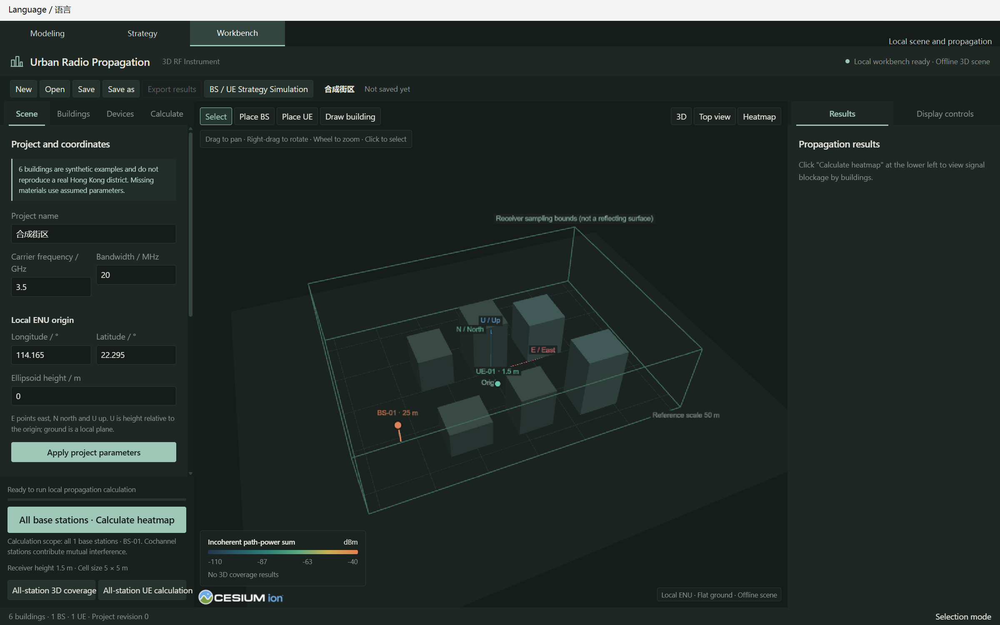
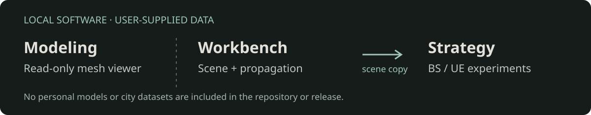

# RAN Workbench

**Build a radio scene. Inspect propagation. Experiment with NR strategies.**

[English](README.md) · [简体中文](README.zh-CN.md) · [Download for Windows](https://github.com/LINYEANSHU/ran-workbench-windows/releases/latest)

Windows x64 desktop application · 中文 / English · Apache-2.0



A local desktop workbench for editing buildings and BS/UE deployments, tracing radio propagation with Sionna RT, and exploring a subset of 3GPP NR system strategies. Three workspaces share one window; application assets are bundled locally.

## Start on Windows

1. Download `RANWorkbench-1.0.0-windows-x64.zip` from [Releases](https://github.com/LINYEANSHU/ran-workbench-windows/releases).
2. Extract the **entire folder** to a writable location. Keep `_internal` and `THIRD_PARTY_LICENSES` beside the executable.
3. Launch `RANWorkbench.exe`. The generated six-block synthetic scene is ready to edit.
4. Select **Language / 语言 → English / 简体中文**. The preference is saved; switching keeps the current scene and experiment drafts.

The packaged app needs no Python, Node.js or external browser. CUDA propagation requires a compatible NVIDIA GPU and driver. Editing, model inspection and the explicitly labelled synthetic Strategy demonstration can be used without running CUDA. **Windows is the only supported platform**; Linux and macOS builds are not provided.

## Three workspaces



| Workspace | What you can do |
| --- | --- |
| **Workbench** | Edit polygons, circular buildings, material assumptions and BS/UE placement; import GeoJSON; calculate coverage, multi-BS heatmaps, multipath and frequency response; export JSON/CSV. |
| **Strategy** | Edit a BS/channel/UE graph; configure CSI feedback, scheduling, link adaptation and HARQ; inspect slot events and compare A/B runs. Real city-channel mode uses CUDA. |
| **Modeling** | Open your own compatible `.city.json` manifest and local meshes, inspect geometry and save screenshots. This is a read-only viewer; these detailed meshes are not used by the propagation solver. |

Strategy starts from a copy of the Workbench scene. Use **Update scene from Workbench** to create a fresh experiment after changing the scene; results and edits do not automatically write back across workspaces.

**Software only:** this repository and release contain no personal city models, downloaded city datasets or saved user projects. Test geometry is generated by code. Supply your own data when using import or Modeling.

## Run from source

Use Windows x64, Python **3.12** and Node.js **22**. From the repository root in PowerShell:

```powershell
py -3.12 -m venv .venv
.\.venv\Scripts\python.exe -m pip install -r requirements-lock.txt
npm ci
.\.venv\Scripts\python.exe main.py --language en
```

To build a portable Windows folder:

```powershell
.\.venv\Scripts\python.exe tools/build_windows.py --dist-dir dist/public
```

The output is `dist/public/RANWorkbench/`. Choose a fresh output directory for each build so stale user files cannot enter the release. Dependencies and license files are collected from the installed environment; model folders are never copied.

## Automation and verification

The same executable provides the desktop, local CLI and experiment CLI:

```powershell
.\RANWorkbench.exe --language en
.\RANWorkbench.exe --workspace Strategy
.\RANWorkbench.exe --cli state
.\RANWorkbench.exe --system-cli init .\experiment.ran-sim.json
.\RANWorkbench.exe --system-cli validate .\experiment.ran-sim.json
```

The local automation interface uses a per-instance token. Keep endpoint records private. Start with `--no-automation` to disable it. See the [Windows guide](docs/windows-guide.md) for file formats, scene updates and compute modes.

For source verification:

```powershell
.\.venv\Scripts\python.exe -m pytest
node --test tests/*.test.cjs
```

Windows CI runs the source checks. Real GPU acceptance is a separate hardware-dependent check; a synthetic demonstration is not evidence of CUDA performance.

## Model boundaries

- Propagation uses flat local ground and extruded building geometry, assumed materials and thin-layer transmission. Diffraction is disabled; interactions near building edges are excluded by a 5 cm band. Sampling can miss paths.
- NR implements a Release 18 subset: CQI/MCS table 1, TBS and one/two-port Type-I codebooks. Scheduling, feedback transport and HARQ are system abstractions; higher-dimensional codebooks and a complete protocol stack are not implemented.
- Link curves and EESM parameters have calibration limits. Results have not been validated against field measurements or commercial equipment.
- User-entered names and saved project contents retain their original language. Interface switching does not translate or rewrite user data.

## Contribute and license

See [CONTRIBUTING.md](CONTRIBUTING.md). Keep private models, credentials and generated results out of Git; publish binaries as Release assets.

Project source: [Apache License 2.0](LICENSE). Dependencies retain their own licenses; see [third-party notices](THIRD_PARTY_NOTICES.md) and the license directory included with the Windows release.
