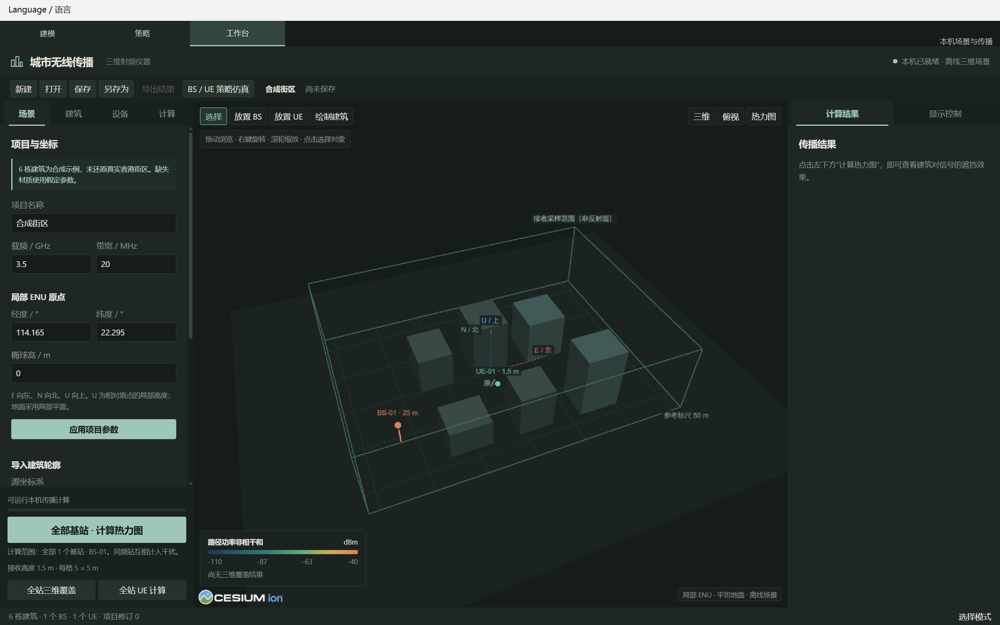

# RAN Workbench

**编辑无线场景，检查传播路径，探索 NR 策略。**

[English](README.md) · [简体中文](README.zh-CN.md) · [下载 Windows 版](https://github.com/LINYEANSHU/ran-workbench-windows/releases/latest)

Windows x64 桌面软件 · 中文 / English · Apache-2.0



在本机编辑建筑和 BS / UE 部署，使用 Sionna RT 计算无线传播，并探索部分 3GPP NR 系统策略。三个工作区共用一个窗口，界面资源随软件提供。

## 在 Windows 开始使用

1. 从 [Releases](https://github.com/LINYEANSHU/ran-workbench-windows/releases) 下载 `RANWorkbench-1.0.0-windows-x64.zip`。
2. 将**整个目录**解压到可写位置，保留 EXE 旁的 `_internal` 和 `THIRD_PARTY_LICENSES`。
3. 启动 `RANWorkbench.exe`，即可编辑由代码生成的六栋合成建筑。
4. 在 **Language / 语言 → English / 简体中文** 切换界面。软件会保存语言偏好，切换时保留当前场景和实验草稿。

打包版无需安装 Python、Node.js 或外部浏览器。CUDA 传播计算需要兼容的 NVIDIA GPU 和驱动；场景编辑、模型查看和明确标注的策略合成演示不需要启动 CUDA。**仅支持 Windows**，不提供 Linux 或 macOS 版本。

## 三个工作区


| 工作区 | 用途 |
| --- | --- |
| **工作台 / Workbench** | 编辑多边形、圆形建筑、假定材质及 BS / UE；导入 GeoJSON；计算覆盖、多基站热力图、多径和频率响应；导出 JSON / CSV。 |
| **策略 / Strategy** | 编辑 BS / 信道 / UE 流程图，配置 CSI 反馈、调度、链路自适应和 HARQ；检查时隙事件及 A/B 对比。真实城市场景信道使用 CUDA。 |
| **建模 / Modeling** | 打开你自己的兼容 `.city.json` 清单和本地网格，查看几何并保存截图。当前是只读查看器，精细网格不参与传播求解。 |

Strategy 使用 Workbench 场景的副本。修改场景后，通过**从 Workbench 更新场景**建立新实验；不同工作区的修改和结果不会自动相互写回。

**只发布软件：**仓库及 release 均不包含个人城市模型、下载的城市数据集或已保存的用户项目。测试几何由代码生成；导入和 Modeling 功能需要自行提供数据。

## 从源码运行

开发环境为 Windows x64、Python **3.12**、Node.js **22**。在仓库根目录运行 PowerShell：

```powershell
py -3.12 -m venv .venv
.\.venv\Scripts\python.exe -m pip install -r requirements-lock.txt
npm ci
.\.venv\Scripts\python.exe main.py --language zh-CN
```

构建 Windows 便携目录：

```powershell
.\.venv\Scripts\python.exe tools/build_windows.py --dist-dir dist/public
```

输出为 `dist/public/RANWorkbench/`。每次构建使用新的输出目录，防止旧文件混入。构建器从已安装环境收集依赖与许可证，不复制模型目录。

## 自动化与验证

同一个 EXE 提供桌面、本机 CLI 和实验 CLI：

```powershell
.\RANWorkbench.exe --language zh-CN
.\RANWorkbench.exe --workspace Strategy
.\RANWorkbench.exe --cli state
.\RANWorkbench.exe --system-cli init .\experiment.ran-sim.json
.\RANWorkbench.exe --system-cli validate .\experiment.ran-sim.json
```

本机自动化接口使用每个实例独立的令牌，请勿公开连接记录。使用 `--no-automation` 可禁用接口。文件格式、场景更新和计算方式见 [Windows 使用指南](docs/windows-guide.zh-CN.md)。

源码验证：

```powershell
.\.venv\Scripts\python.exe -m pytest
node --test tests/*.test.cjs
```

CI 仅运行 Windows 源码检查。真实 GPU 验收需要单独在对应硬件上执行，合成演示不能证明 CUDA 性能。

## 适用范围

- 传播模型采用局部平地、挤出建筑、假定材质和薄层透射；关闭绕射，并排除距建筑棱边 5 cm 范围内的交互。射线采样可能漏检路径。
- NR 实现 Release 18 的部分功能：CQI / MCS table 1、TBS、一 / 二端口 Type-I 码本。调度、反馈承载和 HARQ 是系统级抽象，未实现高维码本或完整协议栈。
- 链路曲线和 EESM 参数存在校准边界；结果未经现场测量或商用设备验证。
- 用户输入的名称和已保存项目保留原语言，界面切换不会翻译或改写用户数据。

## 参与开发与协议

见 [贡献说明](CONTRIBUTING.md)。请勿提交私人模型、凭证或生成结果；二进制包放入 GitHub Releases。

项目源码采用 [Apache License 2.0](LICENSE)。依赖保留各自协议，详见[第三方声明](THIRD_PARTY_NOTICES.md)及 Windows 包中的许可证目录。
